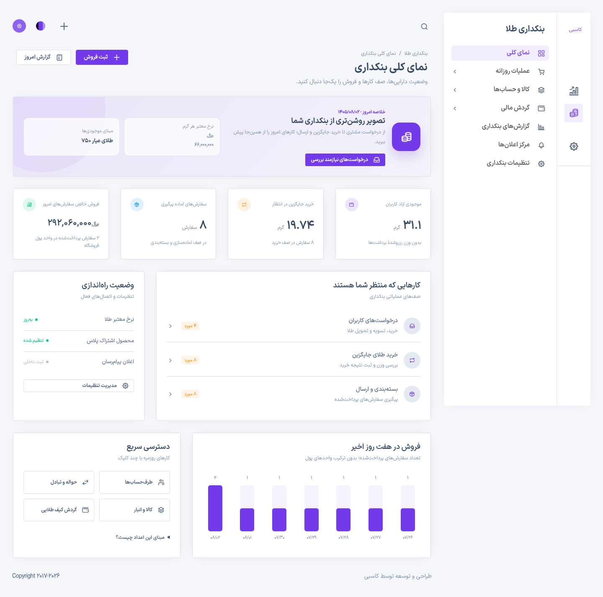
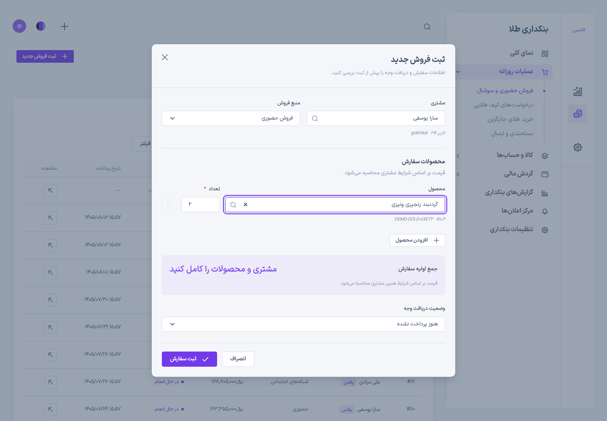

# Kasebi ERP 0.21.1 — بازطراحی رابط بنکداری

[دانلود افزونه](kasebi-erp-0.21.1.zip) · [راهنمای فارسی](INSTALL-fa.md)

رابط دوازده صفحهٔ بنکداری با قلم، رنگ، کارت‌ها و منوی خود ERP بازطراحی شده است. مسیر شروع پس از فعال‌سازی ماژول: **ERP ← بنکداری طلا ← نمای کلی**.

جست‌وجوی مشتری و کالا، پیش‌نمایش قیمت فروش، فرم‌های پنجره‌ای، فیلتر و صفحه‌بندی، گزارش با تاریخ شمسی، حالت تاریک و نمایش موبایل اضافه یا بازطراحی شده‌اند. پنل پلاس و کیف عمومی هم هماهنگ شده‌اند. ساختار داده تغییر نکرده است.

## تصاویر
تصاویر با دادهٔ ساختگیِ محیط آزمون تهیه شده‌اند؛ داده‌های نمونه وارد سایت نصب‌شده نمی‌شوند.

[تصویر کیف طلایی در موبایل](previews/gold-ui-member-wallet-mobile.png)

## نصب و بررسی
از سایت و پایگاه داده پشتیبان بگیرید و ابتدا روی محیط آزمایشی نصب کنید. فایل زیپ جایگزین نسخهٔ قبلی همین افزونه است. ووکامرس فعال باشد و ماژول «بنکداری و کیف طلایی» در ERP فعال شود. سپس از نمای کلی به فروش، درخواست‌ها، حساب‌ها و گزارش‌ها بروید. صفحات عمومی از کدهای `[kerp_plus]` و `[kerp_gold_wallet]` استفاده می‌کنند.

## اعتبارسنجی
- ۷۲ بررسی پایهٔ مالی و عضویت، ۶۷ بررسی تکمیلی و ۲۹ بررسی رابط فقط‌خواندنی موفق.
- ۴۸ بررسی مرورگر: دوازده صفحه در دسکتاپ و موبایل، جست‌وجو، ثبت فروش آزمایشی، جابه‌جایی داخل ERP و محدودیت دسترسی.
- سبد خرید، مجوزها، محافظت درخواست و غیرفعال‌بودن ماژول بررسی شدند؛ بررسی نحوی همهٔ فایل‌های PHP و دو اسکریپت رابط موفق بود.

## محدودیت
نسخه آزمایشی است. درخواست خرید و تسویهٔ کیف و تأیید خرید جایگزین دستی هستند. اتصال واقعی آب‌شده‌فروش و شرکت بسته‌بندی به قرارداد سرویس نیاز دارد؛ این نسخه چنین اتصالی را فعال نمی‌کند. پیش‌نمایش فروش پیش از مالیات است.
