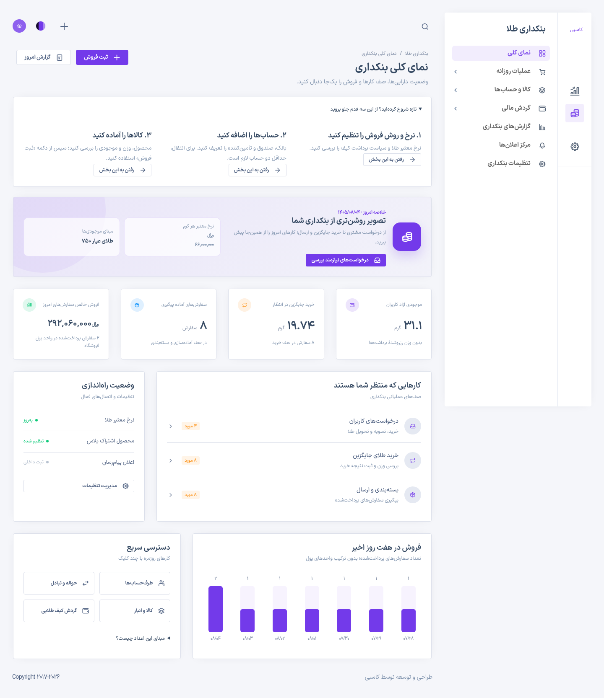

# کاسبی ERP — نسخه ۰٫۲۱٫۲

[دانلود فایل نصب](kasebi-erp-0.21.2.zip) · [راهنمای کامل فارسی](INSTALL-fa.md)

این نسخه مسیرهای روزمرهٔ ماژول بنکداری را ساده می‌کند و ظاهر اصلی ERP را نگه می‌دارد.

## تغییرات
- راهنمای شروع سه‌قدم: تنظیم نرخ و سیاست فروش، تعریف حساب‌ها، آماده‌سازی کالا.
- فروش سه‌مرحله‌ای: مشتری و محل فروش ← کالاها ← بررسی و ثبت. قبل از دکمه نهایی، سفارش ایجاد نمی‌شود.
- عنوان‌های روشن‌تر برای فروش حضوری و شبکه‌های اجتماعی، انتقال طلا و پول و گردش کیف طلایی.
- انتخاب آگاهانهٔ نتیجه درخواست کیف؛ دیگر «انجام شد» از پیش انتخاب نیست و اثر تصمیم روی موجودی توضیح داده می‌شود.
- بازیابی یک‌بارهٔ اطلاعات مجاز فرم مدیریتی پس از خطای ثبت؛ اطلاعات تا ده دقیقه فقط برای همان مدیر و صفحه نگه داشته می‌شوند. تأیید مالی دوباره لازم است؛ رمز، کلید سرویس و توکن نشست در پیش‌نویس ذخیره نمی‌شوند.
- تنظیمات تخصصی نرخ در بخش بازشونده، راهنمای متصل به ورودی‌ها و پیام موفقیت متناسب با عملیات.

## نصب و بررسی
از سایت و پایگاه داده پشتیبان بگیرید و ابتدا روی محیط آزمایشی، افزونه قبلی را با این زیپ جایگزین کنید. ووکامرس باید فعال باشد. مسیر شروع: **ERP ← بنکداری طلا ← نمای کلی**. ماژول بنکداری باید فعال شده باشد. ساختار داده و محاسبات مالی در این نسخه تغییر نکرده‌اند.

## تصاویر
تصاویر از مرورگر واقعی و با دادهٔ ساختگیِ آزمون تهیه شده‌اند؛ داده‌های نمونه در فایل نصب نیستند.

[نمای مرحله نهایی فروش در موبایل](previews/simple-final-mobile.png)

## بررسی‌ها و حدود نتیجه
۷۲ بررسی پایه مالی، ۶۷ بررسی تکمیلی، ۲۹ بررسی رابط فقط‌خواندنی، ۵۸ بررسی مرورگر و ۱۱ بررسی ویژه بازیابی فرم موفق بودند. سبد خرید، مجوزها، محافظت درخواست، غیرفعال بودن ماژول و نحو PHP و JavaScript بررسی شدند. بازیابی واقعیِ فروش چندکالایی ناموفق و ثبت موفق پس از اصلاح نیز آزموده شد.

این آزمون‌ها جای آزمون حضوری با کاربر کم‌تجربه را نمی‌گیرند. بازیابی فرم به جاوااسکریپت فعال نیاز دارد و فرم عمومی کیف را پوشش نمی‌دهد. نسخه آزمایشی است؛ خرید جایگزین و درخواست‌های کیف با تأیید دستی مدیر انجام می‌شوند. اتصال واقعی آب‌شده‌فروش و شرکت بسته‌بندی هنوز فعال نشده است. مبلغ نمایش‌داده‌شده در پیش‌نمایش فروش پیش از مالیات است.
