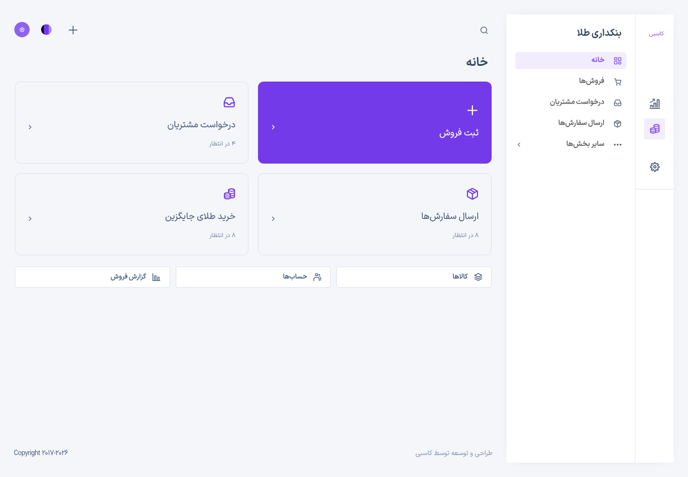

# کاسبی ERP ۰٫۲۱٫۳

[دانلود افزونه](kasebi-erp-0.21.3.zip)

پنل خلوت‌تر برای کارهای روزمره: چهار دکمهٔ اصلی، فرم فروش مرحله‌ای، فهرست‌های کوتاه و دکمه‌های خواناتر. جزئیات سفارش داخل ERP باز می‌شود. تنظیمات و ابزارهای کمترمصرف زیر «سایر بخش‌ها» هستند.

پس از نصب: **ERP ← بنکداری طلا ← خانه**

ابتدا روی نسخهٔ آزمایشی سایت نصب کنید. محاسبات و ساختار مالی تغییر نکرده‌اند. این نسخه اتصال واقعی آب‌شده‌فروش و شرکت بسته‌بندی را اضافه نمی‌کند؛ بررسی و تأیید کیف و خرید جایگزین همچنان دستی است.

## تصویر پنل

[نمای موبایل](previews/clean-home-mobile.png) · [ثبت فروش در موبایل](previews/clean-sale-mobile.png)

تصاویر با دادهٔ ساختگی تهیه شده‌اند. داده‌های نمونه در فایل نصب نیستند.

بررسی‌ها: ۷۲ آزمون پایه، ۶۷ آزمون تکمیلی، ۲۹ آزمون رابط، ۶۳ بررسی مرورگر و ۱۱ بررسی بازیابی فرم موفق بودند. آزمون سبد، مجوز و غیرفعال‌بودن ماژول و بررسی نحو PHP و JavaScript نیز موفق بود. بررسی با کاربر کم‌تجربه هنوز انجام نشده است.
